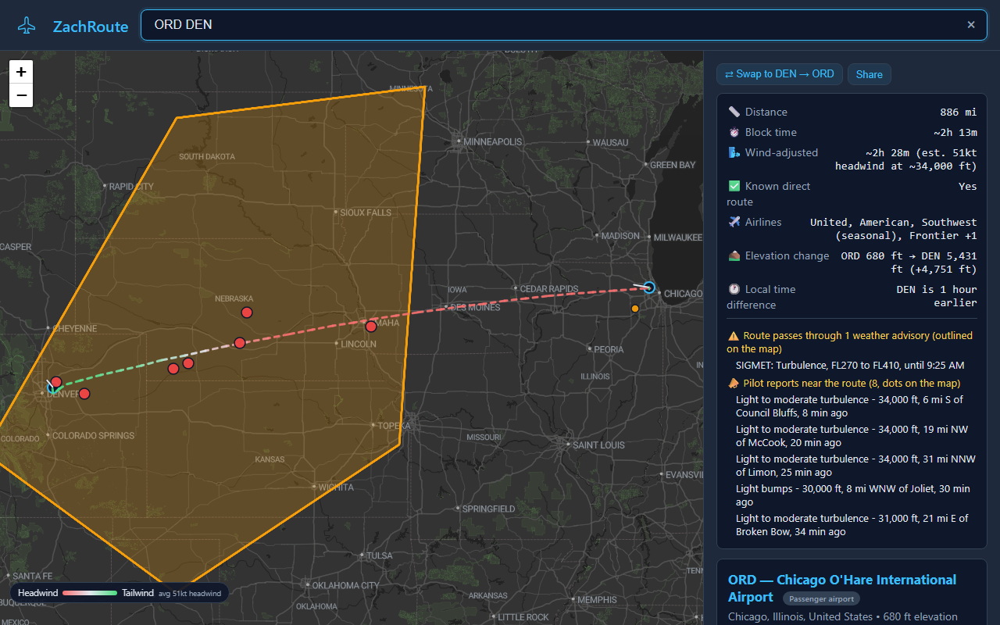
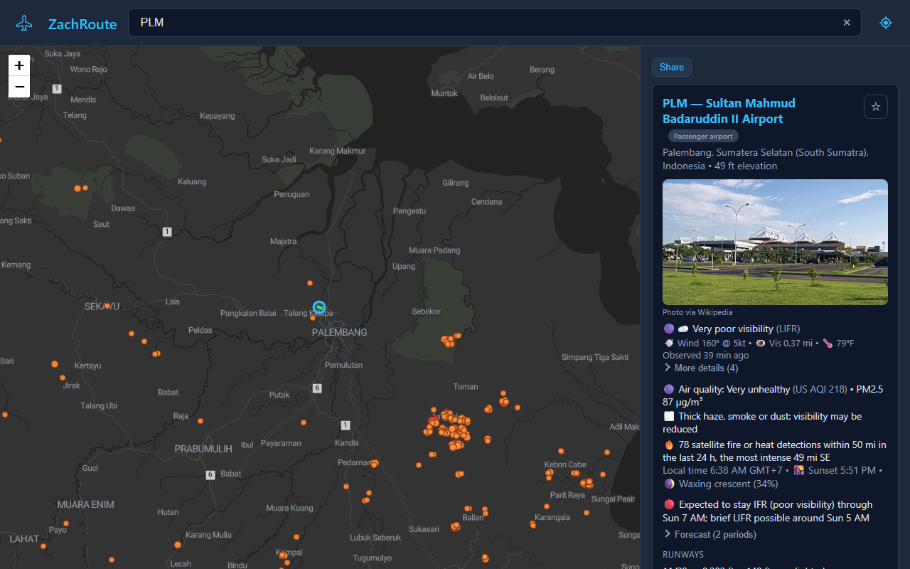
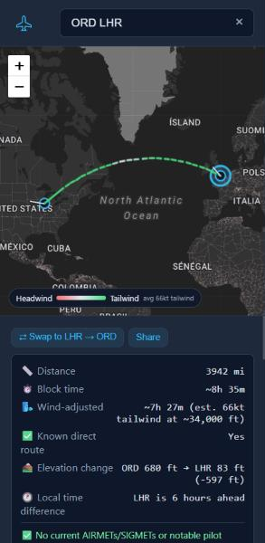
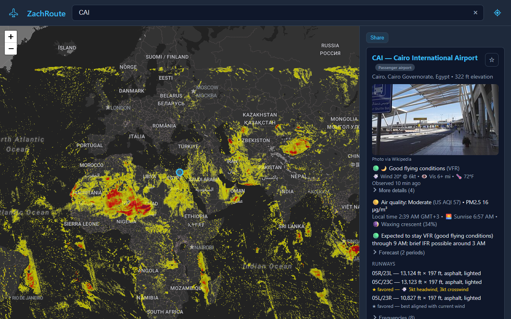

# ZachRoute

**An airport and route map for your phone, for anywhere in the world. Type an airport code or a city to get live weather in plain English, runways, delays and hazards, and the great-circle route between two airports with the forecast winds along it.**

[](https://github.com/ZachGSnow/zachroute/actions/workflows/ci.yml)
[](LICENSE)

Live at **[zachroute.pages.dev](https://zachroute.pages.dev)**. For information only: not for navigation or flight planning.



| Airport view: Palembang, Indonesia, with smoke from nearby fires | On a phone: Jakarta to Bali crosses volcanic ash |
|---|---|
|  |  |



## Why

Aviation data is free and public, but it is scattered across a dozen sites and written in
shorthand (`TAF KORD 161120Z 1612/1718 28012KT P6SM BKN035`). I wanted one fast page that answers
"what is happening at this airport and on this route right now" in plain English, keeps working
for airport lookups when the signal drops, and installs on a phone like an app. It started as a
companion to a FlightWall display: see a plane overhead, look up where it is going.

## Features

**Search**
- Airport codes (IATA, ICAO, FAA), city or airport names, and routes: `ORD`, `Chicago`, `ORD DEN`,
  `Chicago to Denver`, `chicago denver`, `portland me`, `london uk`.
- Suggestions appear as you type (airports, and routes once the first airport is settled); the map
  only changes when you pick one or press Enter.
- Focusing the empty search box lists your favorite airports and last 8 searches (kept on the
  device only). Star an airport on its card to make it a favorite; favorites also appear on the
  start screen.
- Ranks the airport you most likely mean (by nonstop destinations) and offers the others in the
  same city as one-tap chips.
- Every result has a shareable link (`?q=ORD+DEN`); the Android back button returns to the
  previous search.

**Airport card**
- Alerts (delays, weather alerts, ash, volcanoes, cyclones, flight restrictions) fold behind one line
  with their count and worst grade; by default they start open only when one is Severe or Extreme.
  Settings, Airport cards sets that, whether the photo shows, and which folding sections (weather
  details, forecast periods, pilot reports, forecaster notes, runways, frequencies, navaids,
  destinations) start open. Tapping a section header opens or folds it on that card.
- Tap an alert chip, a pilot report or the fires line to see it on the map: the map frames it,
  outlines it in white with a popup, and a "Back to airport" button returns to the earlier view.
  NWS warnings use their own area; watches and advisories that only name forecast zones fetch the
  zone outlines from api.weather.gov. FAA delays have no place to show. Test messages from the NWS
  (such as a monthly tsunami warning test) are not shown.
- Current conditions from the latest METAR in plain English, with a "More details" section
  (dewpoint and fog risk, ceiling, altimeter or QNH, density altitude, wind as the tower states it,
  and the forecast freezing level).
- Forecast (TAF) decoded into an outlook ("Conditions drop to MVFR around Fri 6 AM") and a period list.
- Recent pilot reports of turbulence or icing nearby, in plain English.
- US airports: the National Weather Service forecaster's aviation notes from the local forecast
  discussion, in the forecaster's own words (for example, a heads-up about shallow ground fog
  around ORD and MDW the next morning).
- Runways with dimensions and surface, the wind-favored runway with headwind/crosswind
  components, frequencies, navaids, local time, sunrise or sunset, airport photo and history.
- Nonstop destinations from route data, with the airlines that fly them on US routes (US DOT data,
  about three months behind). Routes between US and foreign airports come from DOT T-100 (scheduled
  service in the last 12 months, with the airlines, foreign ones included). Routes between two
  foreign airports come from OpenFlights (2017) and list no airlines.

**Hazards and air near an airport** (worldwide unless noted)
- Volcanic ash over or within 100 miles of the airport, from international SIGMETs.
- US volcanoes at an elevated alert within 100 miles, with the aviation color code.
- Tropical cyclones (hurricanes, typhoons, cyclones in every ocean) within 300 miles, or whose
  forecast cone covers the airport, even when the storm is still far away.
- Traffic, for airports with scheduled flights to or from the US: passengers in the last 12 months,
  the change on the year before, and the busiest routes (US DOT T-100).
- Air quality: the US AQI, or the European AQI at European airports, with PM2.5, a note when
  smoke, dust or haze may reduce visibility, and a heads-up when it is forecast to get worse in the
  next 12 hours.
  Where a ground station within 25 km has reported in the last 3 hours, its measured PM2.5 too, with
  the station, distance and age (OpenAQ).
- Satellite fire and heat detections within 50 miles in the last 24 hours, with the most intense
  one's distance and direction.
- US only: FAA ground stops, ground delay programs and departure/arrival delays, active
  National Weather Service alerts, and temporary flight restrictions (TFRs) within 30 miles.

**Airports near me**: the location button lists the 5 closest airports with scheduled-service codes,
with distance, direction and current flight category, and shows them on the map. The position is
used once and not stored; denying permission just shows a message.

**Routes**
- Great-circle distance, block time, and a wind-adjusted block time from forecast winds at a
  cruise level picked by trip length (about 34,000, 18,000 or 10,000 ft).
- The line is the great circle between the two airports, joined to a schematic departure off the
  wind-favored runway and a 10 nm final approach, and colored by the forecast headwind or tailwind
  along it. It is not an airway or air traffic control routing, and the winds do not change its
  shape.
- The forecast freezing level at both airports, and the lowest along the way when it dips well below
  them.
- A terrain profile of direct routes: terrain height along the great circle (sampled about every 5
  miles, up to 200 points), the forecast freezing level over it, the stretches where terrain rises
  above the freezing level, and the highest terrain and where it is. Airliners cruise far above
  terrain, but the highest ground decides the escape plan after a depressurization or engine
  failure.
- Traffic on routes touching the US (US DOT T-100, last 12 months, both directions): passengers,
  flights, how full they were, the busiest month, the change on the year before, the airlines by
  share of passengers and the main aircraft.
- When there is no nonstop, one-stop and two-stop connections from the route data (not live
  schedules) are drawn and listed; the selected itinerary shows per-leg distance and time.
- Weather advisories the route passes through are listed and drawn: US G-AIRMETs (the graphical
  AIRMETs that replaced the text ones: turbulence, icing, low ceilings, mountains in cloud, strong
  surface wind, low-level wind shear, shown as the 3-hourly snapshot nearest now) and SIGMETs, and
  international SIGMETs worldwide (thunderstorms, turbulence, icing, volcanic ash, tropical
  cyclones), each with the flight information region (FIR) that issued it, and US center weather
  advisories (short-notice warnings from an air traffic control center, valid up to 2 hours). Volcanic ash gets its
  own warning at the top, since flights avoid it at every altitude.
- Tropical cyclones the route passes within 150 miles of, or through the forecast cone of.
- US temporary flight restrictions the route crosses, with a link to the FAA's details. Most reach
  only a few thousand feet, so they matter near the airports rather than at cruise.
- Pilot reports of turbulence or icing near the route.
- The hazard list folds behind a one-line summary (count by kind and the worst grade), opening by
  itself when something is Severe or Extreme; volcanic ash always stays above it. Settings, On a
  route chooses which kinds are drawn on the map (all by default; the list names any that are not)
  and "Focus on the route" (on by default): while a route is shown, the full advisory, pilot report,
  cyclone and TFR layers step aside so only what lies along the route is drawn, and come back when
  the route is cleared.
- Tap a row of the hazard list (an advisory, cyclone, TFR, pilot report or the ash warning) to frame it
  on the map with the route still drawn; "Back to route" returns to the whole route.
- Space weather, on routes that reach 60 degrees north or south: a solar radiation storm (S1 and
  up; polar flights may be rerouted), a radio blackout (R2 and up) or a geomagnetic storm (G2 and
  up), both of which degrade HF radio, from NOAA's space weather scales.

**Map layers** (the gear button opens Settings, where layers are on/off switches grouped into folding sections: Map, Airports and routes, Weather, Flight hazards, Natural hazards, Airspace and charts; each section shows how many are on, and "Turn off all layers" and "Reset all settings" are at hand): a dark, light or satellite base map (satellite is a cloud-free mosaic, not live imagery), nonstop connections, airport size layers, weather stations
(wind arrows, with a ring only when conditions are below VFR; or temperatures colored cold to hot,
marked where it is at or below freezing and where temperature and dewpoint are close enough for
fog), the forecast freezing level (shaded dark blue where it is low, with values in thousands of
feet; from zoom 3), airspace from zoom 7 (US from the FAA: class B, C and D, and prohibited,
restricted, warning, alert and danger areas and military operations areas; elsewhere from openAIP:
control zones, terminal and control areas by ICAO class, and prohibited, restricted and danger
areas; with floors, ceilings and times of use; not for navigation), terrain shading (light relief worldwide, pale above 10,000 ft), FAA
aeronautical charts for the US (the VFR sectional or the IFR low enroute
chart, from zoom 8, with the edition date; not for navigation), weather radar (the US from NEXRAD via the Iowa Environmental Mesonet, about
1 km detail; elsewhere RainViewer, coarser, from countries that share their radar; or, for the US,
storm tops: how high the storms reach, to compare with cruise altitude), pilot reports,
weather hazards, the US thunderstorm forecast (the Aviation
Weather Center's TFM Convective Forecast for 4, 6 or 8 hours ahead: where storms are expected, how
much of each area they cover, the forecasters' confidence and the storm tops), the US severe storm
outlook (NOAA Storm Prediction Center, today or tomorrow: where large hail, damaging wind or
tornadoes are expected, by risk category),
tropical cyclones (track, forecast track and uncertainty cone), earthquakes (M4.5 and up worldwide in
the last day) and US volcanoes at an elevated alert, US flight restrictions (TFRs), fires detected by satellite in the
last 24 hours, dust and smoke from space (the latest daily pass), satellite clouds (infrared: white is cloud, colors are colder, taller storm tops up to magenta for
the strongest cores; worldwide except near the poles: the Americas, the Pacific, Asia and Australia
from NASA, the newest image every 10 minutes, and Europe, Africa, the Middle East and India from
Meteosat, the newest top-of-the-hour image), the aurora forecast with NOAA's current space weather
levels, day/night shading, approach
distance ticks, and runway outlines with runway numbers when zoomed in.

**Map legend**: a panel at the bottom left explains each layer that is switched on (colors,
scales and marks, in your units). On a phone it starts as a small "Legend" chip; tap it to open.
Hazards share one severity scale: yellow Light, orange Moderate, red Severe, magenta Extreme. Radar
is redrawn on it from the radar strength (plain rain 20-30 dBZ soft blue, then Light 30-40,
Moderate 40-45, Severe 45-50, Extreme 50 and up), so both radar sources look the same; storm tops
by height (Light from 20,000 ft, Moderate 30,000, Severe 40,000, Extreme above 50,000). Pilot
reports are colored by how bad the turbulence or icing was (their shape says which), and fires by
their radiative power. Weather advisories are colored by severity with a symbol for the hazard
(AIRMETs moderate, SIGMETs severe, embedded or line thunderstorms and volcanic ash extreme),
the thunderstorm forecast by how much of the area storms will cover (sparse moderate, medium
severe, solid or a line extreme; dashed when confidence is low), the severe storm outlook by SPC
risk (general thunderstorms soft blue, marginal light, slight moderate, enhanced severe, moderate
and high extreme), tropical cyclones by strength, earthquakes by magnitude (Light from M4.5,
Moderate 5.5, Severe 6.5, Extreme 7.5) and volcanoes by aviation color code (YELLOW light, ORANGE
moderate, RED extreme),
and US flight restrictions by how restrictive they are. Cards and
route lists show the same level as a badge, worst first.

**Phone layout**: the results panel is a bottom sheet. Drag its handle between a one-line peek
(map almost full screen), half (the default for a new result) and full; a tap toggles peek and half.

**Live track**: the radar button in the header shows aircraft in the air around you. It finds your
location once, draws a circle of 1 to 15 miles (Settings, Live track; it stays where it was drawn
until Live track is turned off and on) and follows up to 5 aircraft inside it, the closest first,
refreshing every 10 seconds while the page is visible. Aircraft on the ground, lower than the set
height above the ground (default 500 ft) or slower than the set speed (default 60 kt) are left out.
Each shows as an icon pointing along its track, colored by altitude, with the path flown since
tracking started, a line one minute ahead, and a dashed line to its destination when adsb.lol knows
the flight's route and it fits the aircraft's position and heading (adsb.lol's own check is lenient:
it called a flight landing at ORD "plausible" for Dallas to Charlotte). A card lists callsign, type,
route, altitude, speed, climb or descent and distance; tapping one finds it on the map. To keep the
load on the data source small, Live track pauses after 5 minutes until Continue is tapped, sends
adsb.lol your position rounded to about 1 km, and reuses each answer for 8 seconds. Help is in the
settings footer, next to the version.

**Units**: distances in miles, kilometers or nautical miles, a 12 or 24-hour clock, and weather in US
units (F, inHg, miles) or metric (C, QNH in hPa, visibility in km or metres, read straight from the
METAR where it is reported in metres). Settings, Units; miles and 12-hour by default, and weather units
follow the device's region. Wind stays in knots and altitudes in feet, as aviation sources report them
worldwide.

**App**: installs as a PWA. Search and airport details (runways, frequencies, navaids) work offline
after the first load, since the airport database is precached, along with the last weather seen for
an airport. The map background and all live data need a connection. A new version takes over on the next launch after a deploy. The ? button
opens Help: how to search and read the cards, the severity colors, and an entry for every layer and
setting (what it shows, where, how often it updates, its source and its colors), with a search box;
each setting's info button opens its entry, and a link ending in `#help/radar` opens Help there. The
About screen shows the version, build time and every data source, grouped by kind.

## Quick start

Requires Node.js 22.12 or newer.

```bash
git clone https://github.com/ZachGSnow/zachroute.git
cd zachroute
npm ci
node scripts/etl_ourairports.js     # builds public/data/airports.json (about 8 MB) from OurAirports
npm run dev                          # app at http://localhost:5173 (no /api endpoints)
```

The `/api/*` endpoints (weather, forecast, advisories, cyclones, fires, FAA status, ...) are
Cloudflare Pages Functions. To run them locally:

```bash
cp wrangler.toml.example wrangler.toml
npm run build
npx wrangler pages dev dist          # app plus /api at http://localhost:8788
```

Deploy to your own Cloudflare Pages project:

```bash
npm run build
npx wrangler pages deploy dist --project-name=<your-project> --branch=main
```

## Configuration

| Setting | Where | Notes |
|---|---|---|
| API keys (optional) | Cloudflare Pages secrets (Settings, Variables and Secrets, for Production and Preview); locally `.dev.vars` (copy of `.dev.vars.example`, gitignored) | `FIRMS_MAP_KEY` ([free NASA FIRMS map key](https://firms.modaps.eosdis.nasa.gov/api/map_key/)) switches fires from MODIS to VIIRS; `OPENAQ_API_KEY` ([free OpenAQ key](https://explore.openaq.org/register)) adds measured PM2.5 to airport cards; `ADSBLOL_API_KEY` ([adsb.lol key](https://www.adsb.lol/mmb), sent in the `x-api-key` header) turns on Live track, which stays off without it. Keys are read only by Pages Functions, never sent to the browser or committed; without them the app falls back to the keyless sources. |
| KV namespace IDs | `wrangler.toml` (copy of `wrangler.toml.example`, gitignored) | Create with `npx wrangler kv namespace create LORE_KV` (and `--preview`). KV caches upstream responses for 5 to 30 minutes (7 days for airport history); the app works without it. |
| Map tiles | [Stadia Maps](https://stadiamaps.com) dashboard | Tiles use Stadia domain authentication: add your site's domain in the dashboard. `localhost` works without registration. No API key is stored in the code. |
| User-Agent for upstream APIs | `package.json` `name`, `version`, `homepage` | Sent with every server-side request (aviationweather.gov, the FAA, GDACS, NASA FIRMS and Wikipedia), since several sources ask callers to identify themselves. |
| Route corrections | `scripts/route_overrides.json` | Add or remove nonstop routes the source data gets wrong (small airlines are not in the DOT data). |
| Starter lore set | `node scripts/prefetch_wiki_lore.js [HUB]` | Pre-downloads Wikipedia summaries for a hub and its nonstop destinations (default `ORD`). |

Open-Meteo (winds aloft, air quality) is free for non-commercial use; a commercial deployment needs
an Open-Meteo API plan.

### Refreshing the data

```bash
npm run data           # OurAirports ETL + world airspace + US DOT routes and traffic (downloads about 220 MB) + route merge
npm run etl:airspace   # world airspace only (openAIP exports, about 72 MB, about 1.5 minutes)
npm run etl:t100       # route and airport traffic only (BTS T-100, 24 months, about 1.5 minutes)
npm run check:codes    # list BTS airport codes that do not match an airport's IATA code
```

When an airport's code changes (Palm Beach went from PBI to DJT in 2026), BTS reports the old code
for the months before the change and OurAirports keeps the old ident. Add the change to
`shared/iataRenames.js` and every build script maps the old code to the new one; the old code
stays searchable and the card shows "formerly ...".

Airspace outside the US changes on the 28-day AIRAC cycle, so rebuild it at each release. The
generated files (`public/data/airports.json`, `public/data/airspace/`) are gitignored. Run it every
few months. The route merge refuses to run without the airport database so US
routes never silently fall back to stale data.

## How it works

A static TypeScript app (Vite, Leaflet) with a small set of Cloudflare Pages Functions that proxy
and trim upstream APIs and cache them in KV. All math (great circles, winds, approach geometry,
search ranking, forecast decoding, hazard geometry) runs in the browser. Build-time scripts turn
public datasets into the bundled airport and route data. See [ARCHITECTURE.md](ARCHITECTURE.md)
for the design and the reasoning behind the main decisions.

## Limitations

- Routes are great circles, not airways or air traffic routing, and connections come from route
  data, not live schedules. Routes between two foreign airports use OpenFlights data from 2017.
- Air quality is a model estimate (Copernicus CAMS). A measured PM2.5 reading is added only where a
  ground station within 25 km reported in the last 3 hours (with the OpenAQ key); low-cost sensors
  are named as such. The measured line rates PM2.5 alone, while the model AQI takes the worst of
  several pollutants, so the two can differ.
- Tropical cyclone positions are from the latest official advisory, typically several hours old.
- An airport card loads its data when you search and does not refresh while it is open; search
  again for newer data.
- Delays and weather alerts are US only; there is no free equivalent for other countries.
- Meteosat images come without a temperature scale, so they are matched to NASA's satellites where
  both see the same clouds (see `src/ts/meteosatCalibration.ts`): expect a band's edge to be a few
  degrees off. They also stop at about -65 C, so their strongest storms show as solid red, never
  the magenta cold cores the NASA satellites show.
- Radar outside the US covers only countries that share their radar with RainViewer, at zoom 7
  detail at most; some networks (Mexico's, for one) report in coarse steps, so strong cells can
  show as solid blocks of one level.
- The map UI has no automated browser tests; it is checked by hand and through the screenshots.

## Testing

```bash
npm test
npm run typecheck
```

Every integration that parses an upstream response is tested against a real response captured from
the source on 2026-10-16 (`test/fixtures/`): aviationweather.gov METAR, TAF, PIREP (by airport and
by area), METAR by area, AIRMET/SIGMET, G-AIRMET, international SIGMET and the convective forecast (TCF); the FAA NAS status XML; NWS
alerts; GDACS and NHC tropical cyclones; NASA FIRMS fire detections; Open-Meteo winds aloft and air quality;
Wikipedia search and summaries; OurAirports CSVs; OpenFlights `routes.dat`; and the US DOT on-time
CSV. The dust layer's pixel filter is tested on sample pixels; the NASA GIBS tiles themselves are
not. Each test was confirmed to fail when its parser is deliberately broken. Writing these tests
found real bugs: the FAA parser's `<Delay` pattern also matched `<Delay_type>`, so general
arrival/departure delays were never parsed; the international SIGMET feed lists some SIGMETs
twice; and NASA FIRMS' "24h" file actually spans about two days.

Not verified against real data: the FAA ground-stop XML block (no ground stop was active when the
fixtures were captured; the parser follows the published `AirportStatus.dtd` element names). Stadia
domain authentication was checked by HTTP status (200 from the registered domain, 401 otherwise).

The README screenshots come from the running app: `node scripts/capture-screenshots.mjs` drives a
local Chrome or Edge in headless mode against `npx wrangler pages dev dist` and writes
`docs/screenshot-*.png`.

## Data sources, freshness and licenses

The code is MIT licensed. The data it uses keeps its own terms. Freshness was measured on
2026-10-16. "App caching adds" is the most the app's own caches (server, edge and browser together)
can add on top of the source's age.

| Data | Source | Updates at the source | App caching adds | License |
|---|---|---|---|---|
| Current weather (METAR) | [Aviation Weather Center](https://aviationweather.gov) | Hourly, plus special reports when conditions change | Up to 15 min | Public domain (US government) |
| Forecasts (TAF) | Aviation Weather Center | Every 6 hours (3 in some countries), plus amendments | Up to 25 min | Public domain (US government) |
| Pilot reports | Aviation Weather Center | As pilots file them; the last 3 hours are shown | Up to 7 min | Public domain (US government) |
| G-AIRMETs, SIGMETs, international SIGMETs, center weather advisories | Aviation Weather Center | G-AIRMETs every 6 hours, as snapshots 3 hours apart; SIGMETs when issued, valid up to 4 hours (6 for ash and cyclones); CWAs when issued, valid up to 2 hours | Up to 9 min; the map layer redraws every 5 min | Public domain (US government) |
| Route and airport traffic (flights touching the US) | US DOT Bureau of Transportation Statistics T-100 Segment (all carriers), built by `npm run etl:t100` | Monthly, about 3 months behind; in the app as of the last build (the months are on each card) | Static files, browser cache | Public domain (US government) |
| Delay programs (US) | [FAA NAS Status](https://nasstatus.faa.gov) | Continuously | Up to 10 min | Public domain (US government) |
| Weather alerts (US) | [National Weather Service](https://www.weather.gov) | Real time | Up to 5 min | Public domain (US government) |
| Forecaster aviation notes (US) | National Weather Service forecast discussions (api.weather.gov) | About 4 times a day per office, plus updates | Up to 45 min | Public domain (US government) |
| Weather radar and storm tops (US) | NEXRAD composites (base reflectivity, echo tops) from the [Iowa Environmental Mesonet](https://mesonet.agron.iastate.edu) | Every 5 minutes | Up to 10 min (tiles cached 5 min; the layer redraws every 5 min) | Free for any lawful use; credit appreciated (credited in the app) |
| Weather radar (outside the US) | [RainViewer](https://www.rainviewer.com) | Every 10 minutes | Up to 10 min | Free for personal and educational use; credit requested (credited in the app). Zoom 7 at most, 100 requests a minute per viewer, latest frame only |
| Thunderstorm forecast (US, TCF) | Aviation Weather Center | Every 2 hours, for 4, 6 and 8 hours ahead | Up to 15 min | Public domain (US government) |
| Severe storm outlook (US) | [NOAA Storm Prediction Center](https://www.spc.noaa.gov) | Day 1 five times a day, day 2 twice | Up to 25 min | Public domain (US government) |
| Earthquakes (M4.5+, worldwide) | [USGS](https://earthquake.usgs.gov) earthquake feed | Within minutes of each quake | Up to 15 min | Public domain (US government) |
| Volcano alerts (US) | [USGS Volcano Hazards Program](https://volcanoes.usgs.gov) notices | As observatories issue them | Up to 15 min | Public domain (US government) |
| Space weather scales, Kp and aurora forecast | [NOAA Space Weather Prediction Center](https://www.swpc.noaa.gov) | Scales and Kp as conditions change; aurora (OVATION) every few minutes, about 30-90 min ahead | Up to 25 min | Public domain (US government) |
| Airspace (US: class B, C, D and special use airspace) | [FAA](https://adds-faa.opendata.arcgis.com) open data (NASR) | Every 56 days (last edited 28 Sep 2026 when added) | Each 4-degree cell cached a day | Public domain (US government); not for navigation |
| Airspace (outside the US) | [openAIP](https://www.openaip.net) daily per-country exports, built into the site by `npm run etl:airspace` | Daily at openAIP; in the app as of the last build (the date is in each popup) | Static files, browser cache | CC BY-NC 4.0: free for non-commercial use with credit (credited on the map); not for navigation |
| Terrain height along routes | [Open-Meteo](https://open-meteo.com) elevation API (about 90 m terrain data) | Static | Each route cached 30 days, shared | CC BY 4.0, free for non-commercial use |
| Terrain (shading) | [AWS Open Data terrain tiles](https://registry.opendata.aws/terrain-tiles/) (Mapzen; from SRTM, ETOPO1, USGS and other sources) | Static | Browser cache | Open data; credit Mapzen and the sources (credited on the map) |
| Aeronautical charts (US: VFR sectional, IFR low enroute) | [FAA Aeronautical Information Services](https://www.faa.gov/air_traffic/flight_info/aeronav) tile service | Charts every 56 days; the tile service is updated less often (last on 9 Jul 2026), and the app shows its edition date | Tiles cached 1 hour by the browser | Public domain (US government); not for navigation |
| Temporary flight restrictions (US) | [FAA TFR list and map service](https://tfr.faa.gov) | As issued | Up to 15 min | Public domain (US government) |
| Tropical cyclones elsewhere (from JTWC and other agencies) | [GDACS](https://www.gdacs.org), the UN / European Commission Global Disaster Alert and Coordination System | Each storm's advisory every 6 hours, republished by GDACS 1-6 hours later (storms were 5-14 hours past their advisory time when measured) | Up to 40 min | No published license; GDACS provides its data as is, for information only (credited in the app) |
| Tropical cyclones, Atlantic and East and Central Pacific | [National Hurricane Center](https://www.nhc.noaa.gov) advisories (CurrentStorms.json; cone and track from NOAA's tropical map service) | Every 6 hours, plus intermediate advisories | Up to 40 min | Public domain (US government) |
| Air quality (Copernicus CAMS models) | [Open-Meteo](https://open-meteo.com) | Hourly model values from model runs twice a day: estimates, not station measurements | Up to 30 min | CC BY 4.0, free for non-commercial use; contains Copernicus Atmosphere Monitoring Service information |
| Measured air quality (PM2.5 at the nearest ground station within 25 km) | [OpenAQ](https://openaq.org) (with `OPENAQ_API_KEY`), from government monitors (AirNow, CPCB, ...) and low-cost sensor networks | Stations report hourly or more often; only readings from the last 3 hours are shown | Up to 45 min | Free key; credit OpenAQ and the original provider (both named on the card) |
| Winds aloft and freezing level | Open-Meteo | Hourly model values (the freezing level on the airport card every 15 minutes) | Up to 15 min (30 min for the freezing level map layer) | CC BY 4.0, free for non-commercial use |
| Fire and heat detections (VIIRS, 375 m, from NOAA-20, NOAA-21 and Suomi-NPP; MODIS 1 km without a key) | [NASA FIRMS](https://firms.modaps.eosdis.nasa.gov) area API (with `FIRMS_MAP_KEY`) or global MODIS file | Several satellite passes per place per day, published minutes to 3 hours later; the app keeps the last 24 hours. VIIRS detections of one pass within about 1 km are summed into one fire | Up to 75 min (the source, the result and the browser are each cached) | Free and open (NASA); credited in the app |
| Satellite clouds (GOES-East and GOES-West from NOAA, Himawari from JMA; infrared band 13) | NASA GIBS | Every 10 minutes | Redraws every 10 min | Free and open (NASA); credited on the map |
| Satellite clouds (Meteosat-12 over Europe and Africa, Meteosat-9 over the Middle East and India; infrared 10.5 / 10.8 um) | [EUMETSAT](https://view.eumetsat.int) | Hourly images used (newer ones exist, but only hourly images are free at once) | Up to 1 hour plus EUMETSAT's 20-50 min delay; redraws every 10 min | Free and unrestricted for hourly images (EUMETSAT data policy, "Essential" data); credited on the map |
| Dust and smoke layer (OMPS aerosol index, NOAA-20) | [NASA GIBS](https://nasa-gibs.github.io/gibs-api-docs/) | One pass per place per day, around 13:30 local time; the app shows today's pass where it has happened and yesterday's elsewhere | Redraws hourly | Free and open (NASA); credited on the map |
| Airport history text and photos | [Wikipedia](https://en.wikipedia.org) | As edited | Up to 7 days | [CC BY-SA 4.0](https://creativecommons.org/licenses/by-sa/4.0/) |
| Airports, runways, frequencies, navaids | [OurAirports](https://ourairports.com/data/) | Nightly | Until you run `npm run data` | Public domain |
| Which Wikipedia article belongs to each airport | [Wikidata](https://www.wikidata.org) | As edited | Until you run `npm run data` | CC0 |
| Current US routes and airlines | [US DOT Bureau of Transportation Statistics](https://www.transtats.bts.gov) on-time data | Monthly, about 3 months behind | Until you run `npm run data` | Public domain (US government) |
| Routes between US and foreign airports | US DOT T-100 Segment (all carriers), `npm run etl:t100` | Monthly, about 3 months behind | Until you run `npm run data` | Public domain (US government) |
| Routes between two foreign airports | [OpenFlights](https://openflights.org/data.php) `routes.dat` | Not updated since 2017 | Until you run `npm run data` | [ODbL 1.0](https://opendatacommons.org/licenses/odbl/1-0/); `src/data/connections.json` is shared under the same license (see [`src/data/README.md`](src/data/README.md)) |
| Map tiles (dark and light base maps, place names on the satellite map) | [Stadia Maps](https://stadiamaps.com) (Alidade Smooth, Alidade Smooth Dark, Stamen Toner labels), OpenMapTiles, OpenStreetMap | Per provider | Not cached by the app | Per provider terms; credited on the map. Stadia's own satellite style needs a paid plan (403 on the free plan), so it is not used |
| Live track aircraft and flight routes | [adsb.lol](https://adsb.lol) API (with `ADSBLOL_API_KEY`): community ADS-B and MLAT receivers; routes from the Virtual Radar Server standing data via adsb.lol | Positions within seconds; routes as maintained | Aircraft reused 8 s per rounded area; routes 6 h per callsign | [ODbL 1.0](https://opendatacommons.org/licenses/odbl/1-0/) (credited on the map, the Live track card, Help and About); the app's `/api/live` output is offered under ODbL 1.0 too |
| Satellite base map | [EOxCloudless](https://cloudless.eox.at) 2025 by EOX IT Services GmbH, a cloud-free Sentinel-2 mosaic (contains modified Copernicus Sentinel data 2025) | Yearly mosaic | Not cached by the app | [CC BY-NC-SA 4.0](https://creativecommons.org/licenses/by-nc-sa/4.0/): non-commercial use with credit (credited on the map) |

The last weather and history seen for an airport stay available offline. For information only:
this app is not for navigation or flight planning.

## License

[MIT](LICENSE), Copyright (c) 2026 Zach Snow. Data licenses above.
